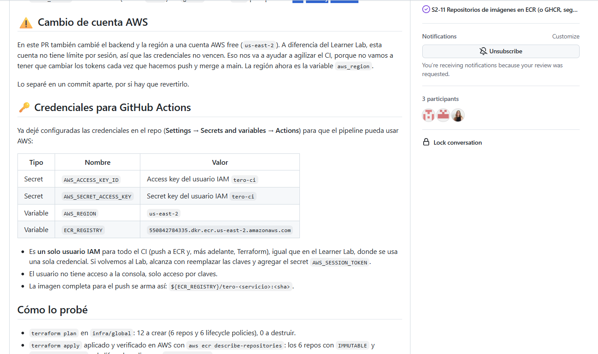
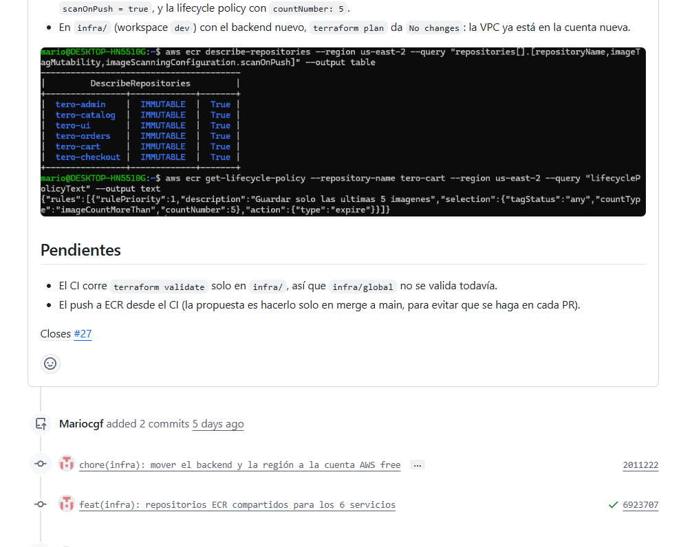
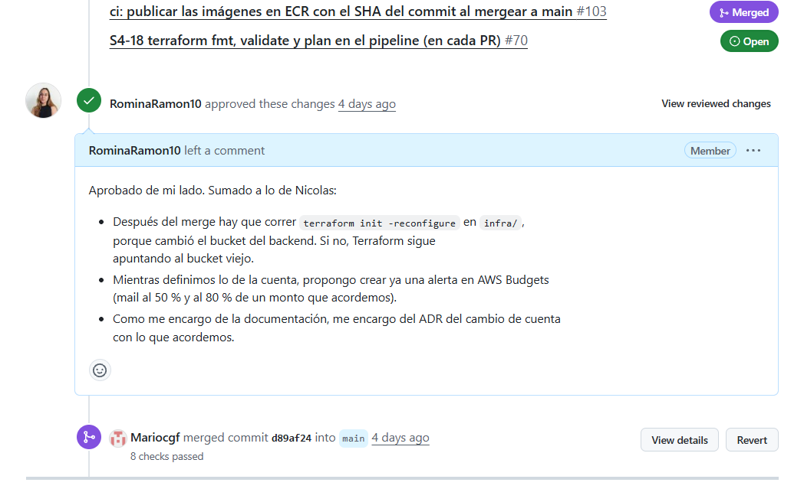
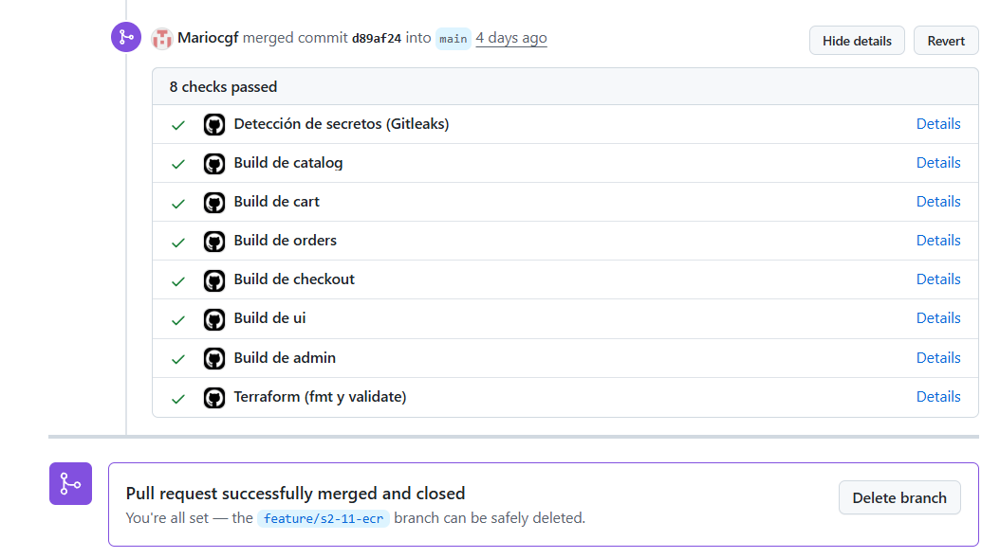

# Evidencia: PR con revisión entre integrantes (PR #102)

Evidencia para la sección 6.3 de la letra del obligatorio: colaboración mediante
Pull Requests con revisiones de código entre integrantes. Tarea S2-17 (#33).

## Datos del PR

| Campo | Valor |
| --- | --- |
| PR | [#102 – feat(infra): repositorios ECR compartidos (S2-11)](https://github.com/Obligatorio-DevOps-ORT/Tero/pull/102) |
| Tarea | S2-11 (cierra #27) |
| Autor | @Mariocgf (Infra) |
| Revisores | @nicokuro (CI/CD) y @RominaRamon10 (Cont./Obs.) |
| Rama | `feature/s2-11-ecr` → `main` (2 commits, 12 archivos) |
| Checks | 8 en verde: Gitleaks, build de los 6 servicios y Terraform (fmt y validate) |
| Resultado | Aprobado por los dos revisores y mergeado el 18/11/2026 (commit `d89af24`) |

Los dos revisores son de áreas distintas a la del autor. La regla de protección
de `main` (`proteccion-main`) no deja mergear sin PR, sin al menos una aprobación
de otra persona y sin los checks en verde.

## Qué propuso el autor

El PR crea los 6 repositorios de ECR con un módulo reutilizable
(`infra/modules/ecr`) en un root aparte (`infra/global`) y explica cada decisión:
repos compartidos entre ambientes, tags inmutables, lifecycle de 5 imágenes,
`scan_on_push` y `force_delete` como variable. También pasa el backend de
Terraform a una cuenta AWS propia (`us-east-2`), en un commit separado por si
hay que revertirlo. Incluye cómo lo probó y qué queda pendiente.

## Qué se discutió en la revisión

**@nicokuro (CI/CD)** validó `infra/global` en local (`init -backend=false` +
`validate`), se ofreció a sumarlo al job de Terraform del CI y dejó tres
comentarios no bloqueantes:

- **Lifecycle de 5 imágenes:** después de 5 merges sin promover a prod, ECR
  borraría la imagen que corre en prod y ECS no podría volver a bajarla si
  reinicia la tarea. También achica la ventana de rollback. Propuso subir el
  número o conservar las imágenes con tag de versión (`v*`) antes de desplegar.
- **Cambio de cuenta:** llevarlo a la reunión y a un ADR: de quién es la cuenta,
  cómo se manejan los costos fuera del free tier y qué pasa si el dueño no está.
- **Credenciales del CI:** a futuro, usar OIDC en lugar de claves guardadas (lo
  recomienda el teórico de IAM). Mientras tanto, limitar los permisos de
  `tero-ci` a ECR y a lo que necesite Terraform.

**@RominaRamon10 (Cont./Obs.)** sumó tres puntos:

- Después del merge, cada integrante tiene que correr `terraform init -reconfigure`
  en `infra/`, porque cambió el bucket del backend.
- Crear una alerta en AWS Budgets (mail al 50 % y al 80 % de un monto acordado)
  mientras se define lo de la cuenta.
- Se comprometió a escribir el ADR del cambio de cuenta.

## Qué salió de la revisión

- **PR #103** (de nicokuro): publica las imágenes en ECR con el SHA del commit al
  mergear a `main`, usando las credenciales que dejó este PR.
- **Issue #70** (S4-18): sumar `infra/global` al job de Terraform del CI.
- **ADR del cambio de cuenta AWS** (S1-15), a cargo de Romina.
- **Retención de imágenes:** queda como pendiente obligatorio antes de desplegar.

## Capturas

### 1. Encabezado, revisores y decisiones del autor

### 2. Cambio de cuenta AWS y credenciales del CI

### 3. Cómo lo probó el autor y pendientes

### 4. Revisión de @nicokuro

### 5. Revisión de @RominaRamon10

### 6. Checks en verde y merge

