# Evolución del tablero Kanban

Evidencia del punto 1.2 de la letra: estado del tablero en tres momentos del proyecto (inicio, mitad y cierre).

- **Tablero:** GitHub Projects "Tareas Obligatorio DevOps" (proyecto #2 de la organización `Obligatorio-DevOps-ORT`).
- **Metodología:** Kanban con límites WIP.
- **Columnas:** Backlog → Por hacer (tareas de la semana) → En curso (WIP 6) → En revisión (WIP 3) → Hecho.
- **Cuándo una tarjeta pasa a Hecho:** cuando su PR está aprobado por alguien de otra área y mergeado (con `Closes #N` la issue se cierra sola). Las tareas sin código pasan a Hecho cuando otro integrante las verifica.
- **Vistas que se capturan en cada momento:** tablero (Backlog), tabla "Plan por semana" (una captura por semana) e Insights (gráfico *Burn up*). Siempre son las mismas, para poder comparar.

## Resumen

| Momento | Tarea | Fecha | Total | Backlog | Por hacer | En curso | En revisión | Hecho |
| --- | --- | --- | --- | --- | --- | --- | --- | --- |
| Inicio | S1-05 ([PR #84](https://github.com/Obligatorio-DevOps-ORT/Tero/pull/84)) | 07/11/2026 | 83 | 80 | 0 | 1 / 6 | 0 / 3 | 2 |
| Mitad | S3-14 ([issue #48](https://github.com/Obligatorio-DevOps-ORT/Tero/issues/48)) | 23/11/2026 | 90 | 56 | 3 | 4 / 6 | 1 / 3 | 26 |
| Cierre | S5-10 | — | — | — | — | — | — | — |

### Tareas por semana del plan

| Semana | Fechas | Tareas al inicio | Tareas a la mitad | Hechas a la mitad |
| --- | --- | --- | --- | --- |
| S1 — Base común | 04–10/11 | 16 | 16 | 11 |
| S2 — Piezas sueltas funcionando | 11–17/11 | 18 | 22 | 14 |
| S3 — Un servicio en Dev de punta a punta | 18–24/11 | 18 | 19 | 1 |
| S4 — Los tres ambientes | 25/11–01/12 | 18 | 18 | 0 |
| S5 — Cierre y defensa | 02–07/12 | 13 | 15 | 0 |
| **Total** | | **83** | **90** | **26** |

## Inicio → mitad (07/11 → 23/11)

### Qué se completó (de 2 a 26 tareas en Hecho)

- **Base del repositorio y del trabajo en equipo (S1):** repo público en la organización, tablero, branch protection en `main` con los checks del CI obligatorios, secretos de `docker-compose.yml` movidos a `.env`, puertos de Postgres y Redis cerrados, `admin/admin` fuera del README.
- **Contenerización (S2):** Dockerfiles multi-stage con usuario no-root para los 6 servicios y `.dockerignore`. Las 6 imágenes pasan de 2,83 GB a 276 MB comprimidas (−90 %).
- **CI (S1/S2/S3):** workflow con Gitleaks y build de los 6 servicios (matrix), plantilla de PR y publicación de las imágenes en ECR con el SHA del commit como tag (S3-07).
- **Infraestructura como código (S1/S2):** backend remoto del estado en S3, módulo de red (VPC y subredes), `.tfvars` por ambiente y repositorios de ECR.
- **Documentación y gestión:** primer PR documentado con revisión real (S2-17) y matriz de observaciones del auditor (S2-19).

### Cambios en el alcance (de 83 a 90 tareas)

El tablero no quedó fijo: se ajustó cuando apareció trabajo nuevo. El salto se ve en el gráfico de Insights entre el 11 y el 12/11.

- **11/11 — S2-21 (#89):** quitar los valores por defecto de los secretos en `admin/src/app.ts`. Se detectó mientras se sacaban los secretos del repo (S1-09).
- **12/11 — 6 tareas nuevas del Plan de Trabajo del docente:** S2-19 (matriz del auditor), S2-20 (README base), S3-19 (`terraform apply` desde el pipeline), S4-19 (métricas de `/metrics`), S5-14 (probar que los quality gates bloquean) y S5-15 (repaso final contra la rúbrica).
- **12/11 — ajustes a tareas existentes por el mismo plan:**
  - S4-18 (`terraform fmt`, `validate` y `plan` en el pipeline) pasó de la semana 4 a la 2, y de prioridad Baja a Alta.
  - Se cambió el título de S5-03.
  - Se agregaron notas a S1-02, S3-04 y S5-04.

### Lo que muestra el tablero a la mitad

- **Se respetan los límites WIP:** En curso 4/6 y En revisión 1/3.
- **Por hacer se usa para la semana:** S1-02, S2-20 y S4-18 son las tareas elegidas para empezar a continuación.
- **Atrasos visibles:**
  - De la semana 1 siguen abiertas S1-01, S1-02, S1-08, S1-15 (en curso) y S1-16.
  - De la semana 2 siguen abiertas:
    - S2-06 (SonarCloud), S2-08 (Trivy) y S2-16 (secretos en el historial), en Backlog.
    - S2-10 (VPC) y S2-12 (cluster ECS), en curso.
    - S2-07 (Semgrep), en revisión.
- **Riesgo para la semana 3:** el hito S3-10 (catalog desplegado en Dev de punta a punta) depende de S2-10 y S2-12 de Infra, que todavía están en curso. Por eso casi toda la semana 3 sigue en Backlog.

## Capturas

### Tablero

| Inicio (07/11) | Mitad (23/11) |
| --- | --- |
| 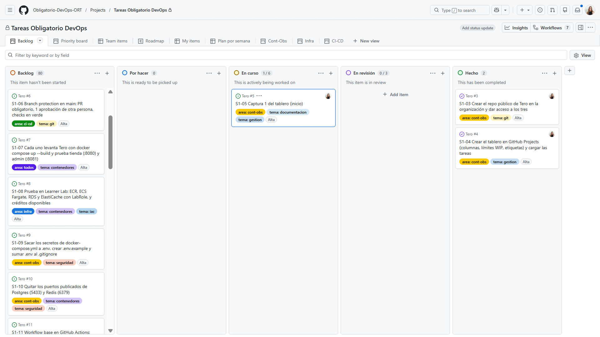 | 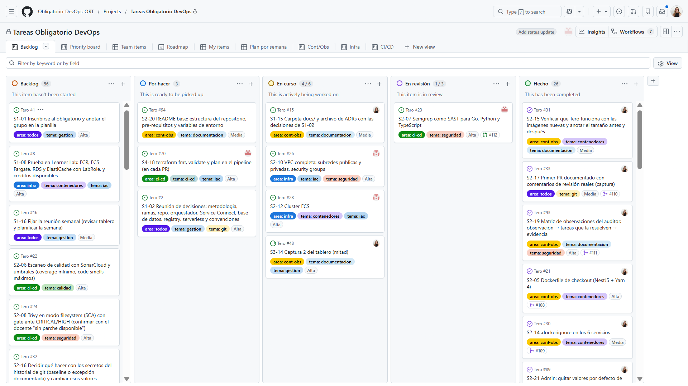 |

### Insights (Burn up)

En la captura de la mitad el rango va del 4/11 al 23/11. La línea verde son las tareas abiertas y la violeta las completadas.

| Inicio (07/11) | Mitad (23/11) |
| --- | --- |
| 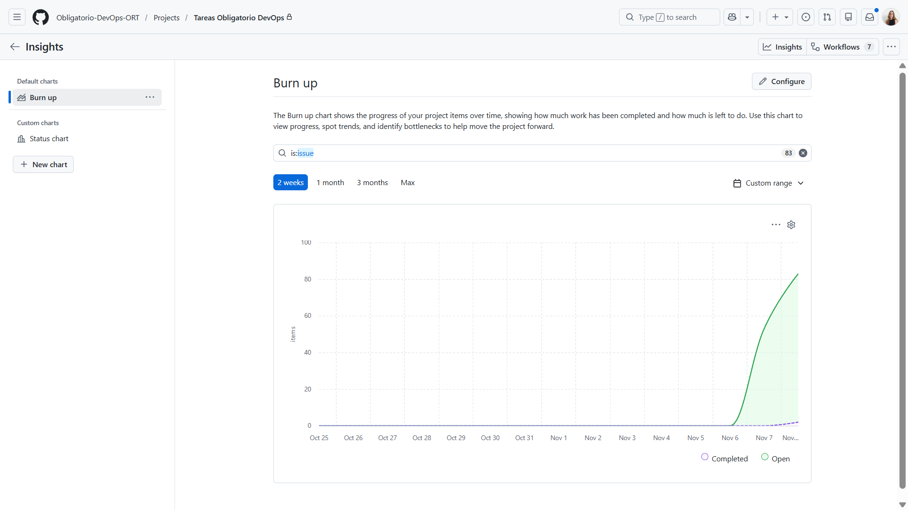 | 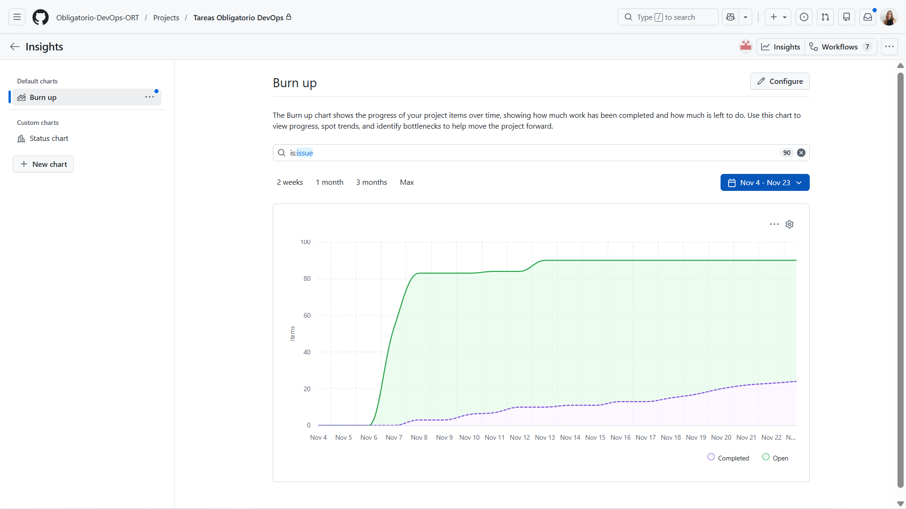 |

### Plan por semana

| Semana | Inicio (07/11) | Mitad (23/11) |
| --- | --- | --- |
| S1 | 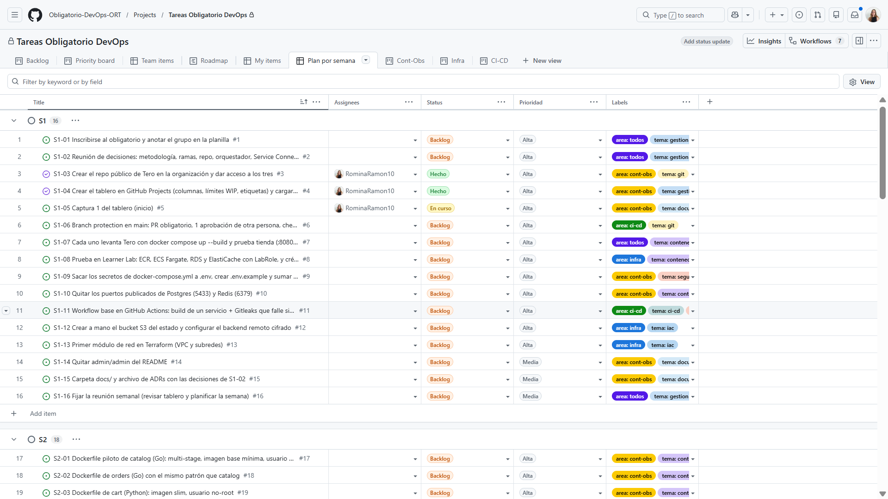 | 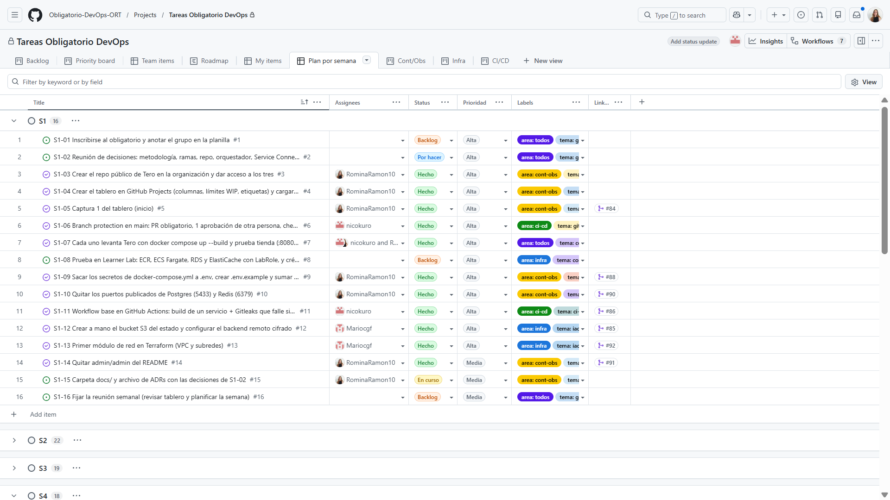 |
| S2 | 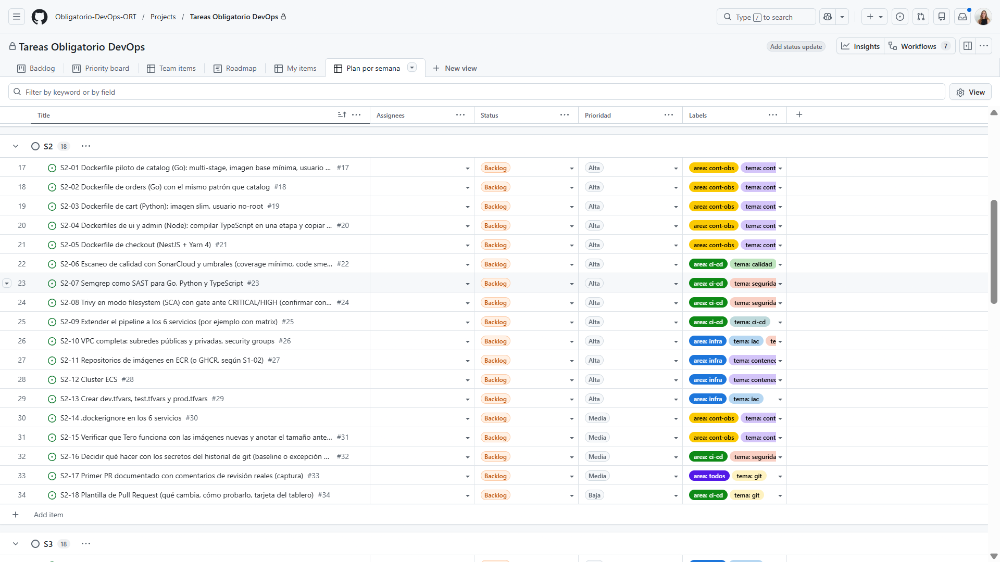 | 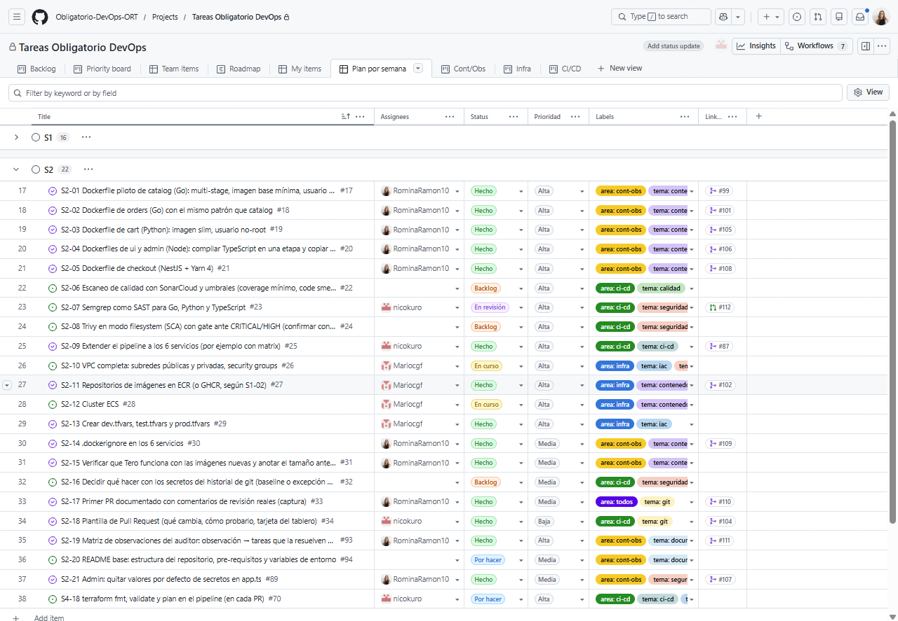 |
| S3 | 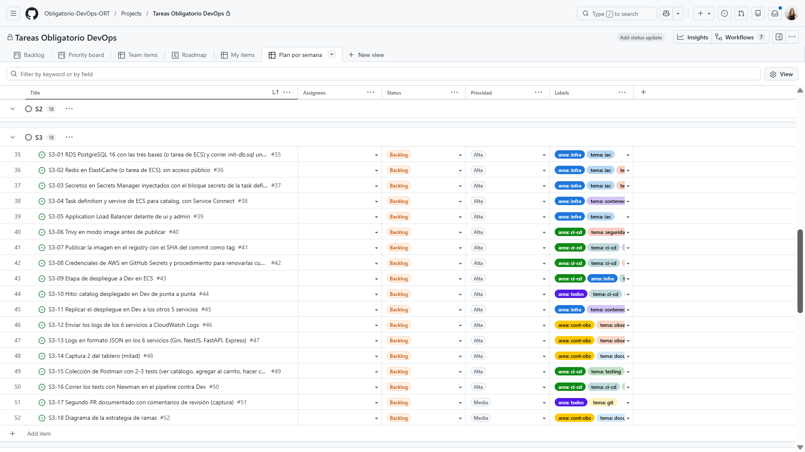 | 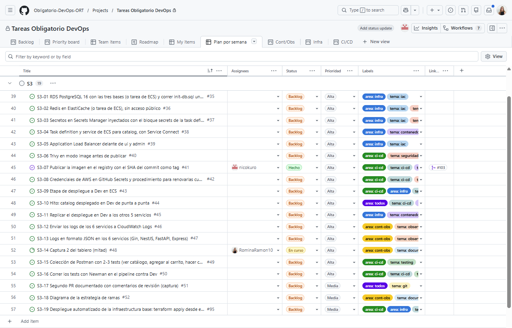 |
| S4 | 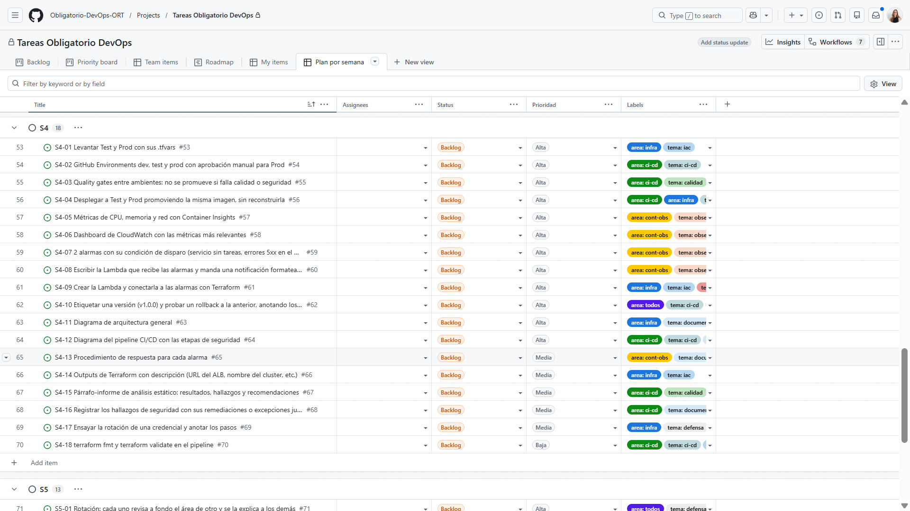 | 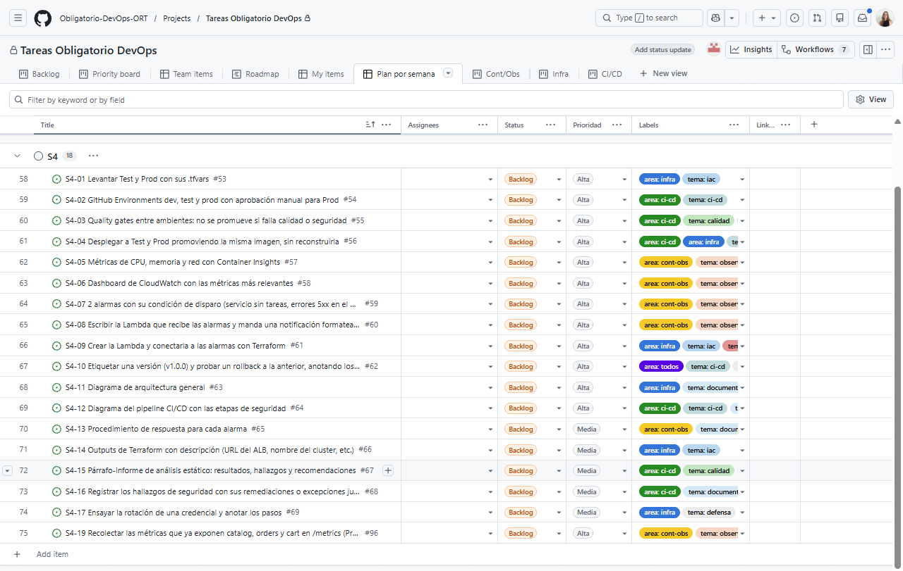 |
| S5 | 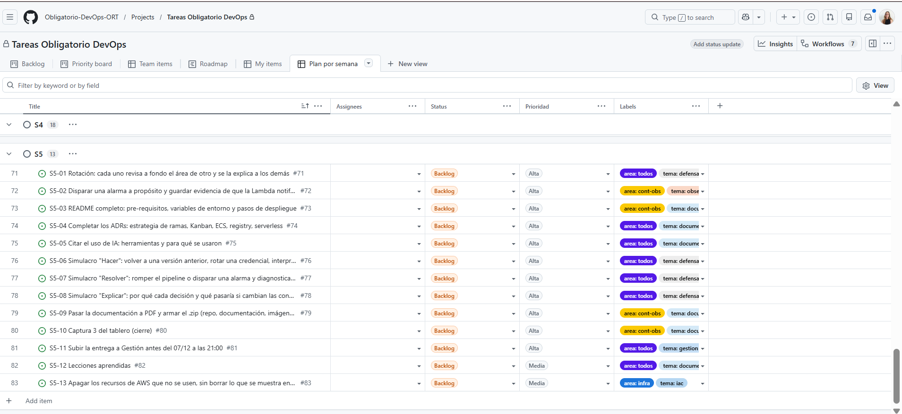 | 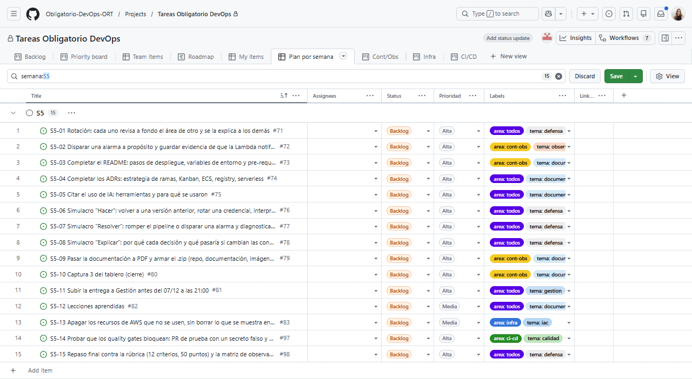 |
